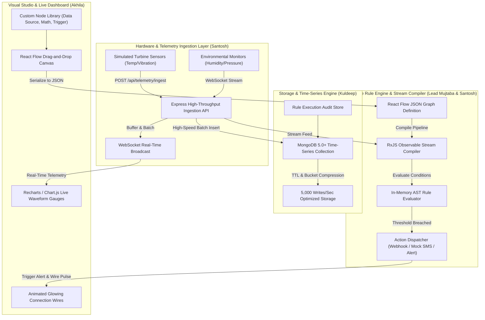

# NexusFlow: Visual IoT Telemetry & Rule Engine
## Master Work Distribution & 22-Day Engineering Sprint Roadmap

> **Organization:** Infotact Solutions (Electronic City, Bengaluru, Karnataka, PN 560100)  
> **Internship Assignment:** Project 1 (Month 2) — Associate L1. Intern (Web Development)  
> **Reference Number:** ITS/WEB/1893  
> **Duration:** 10 November 2026 – 10 December 2026 (1 Month / 22 Sprint Days)  
> **Repository:** [mujtabashaikh2812-stack/NexusFlow-Visual-IoT-Telemetry-Rule-Engine](https://github.com/mujtabashaikh2812-stack/NexusFlow-Visual-IoT-Telemetry-Rule-Engine)

---

## 1. Executive Summary & Team Roster

**NexusFlow** is an enterprise-grade visual IoT stream processing and rule automation platform. It allows non-technical operators to build reactive data processing pipelines on an interactive drag-and-drop canvas (React Flow) while ingesting thousands of high-velocity hardware telemetry events per second into native MongoDB Time-Series collections.

### 👥 Group 3 Engineering Pods

| # | Member Name | Role & Specialization | Dedicated Branch | GitHub Handle | Primary Ownership |
| :-: | :--- | :--- | :--- | :--- | :--- |
| **1** | **Shaikh Mohd Mujtaba (Lead)** | **Team Lead & Systems Architect** | `lead-mujtaba` | `@mujtabashaikh2812-stack` | Architectural Core, Rule Engine Evaluator, Integration Test Suite, Docker, Multi-Pod Merges & Release Gateway |
| **2** | **Santosh Bhujbal** | **Streaming & Ingestion Engineer** | `dev-santosh` | `@sitestock` | Ingestion API, Mock Hardware Generator, RxJS Observable Stream Compiler, MQTT/WebSocket Adapters |
| **3** | **Nedunuri Akhila** | **Visual Canvas & UI Engineer** | `dev-akhila` | `@NedunuriAkhila1405` | React Flow Canvas, Custom Node Library (Sensors, Math, Actions), Animated Glowing Data Wires, Live Telemetry Charts |
| **4** | **Kuldeep Behera** | **Time-Series & Database Engineer** | `dev-kuldeep` | `@kuldeep_behera` | MongoDB 5.0+ Time-Series Collections, 5,000 writes/sec Stress Benchmark, Rule Execution Audit Logs & Aggregations |

---

## 2. System Architecture & Component Flow



---

## 3. Four-Week Milestone Matrix

```
┌────────────────────────────────────────────────────────────────────────────────────────┐
│                               22-DAY MILESTONE SCHEDULE                                │
├─────────────────────┬─────────────────────────────────┬────────────────────────────────┤
│ WEEK                │ BACKEND FOCUS                   │ FRONTEND FOCUS                 │
├─────────────────────┼─────────────────────────────────┼────────────────────────────────┤
│ Week 1 (Days 1–5)   │ Time-Series Setup & Ingestion   │ Canvas Scaffolding & Setup     │
│                     │ - MongoDB Time-Series Schema    │ - React + Vite Initialization  │
│                     │ - Express Ingestion Endpoints   │ - React Flow Canvas Scaffold   │
├─────────────────────┼─────────────────────────────────┼────────────────────────────────┤
│ Week 2 (Days 6–10)  │ Logic Compiler & Stream Setup   │ Node Library & Serialization   │
│                     │ - RxJS Stream Translation       │ - Source, Math & Action Nodes  │
│                     │ - Graph AST Parser              │ - Graph JSON Export / Import   │
├─────────────────────┼─────────────────────────────────┼────────────────────────────────┤
│ Mid-Project Review  │ Ingestion Audit:                │ Graph Serialization:           │
│ (Day 11)            │ - 5,000 writes/sec benchmark    │ - Complex graph export audit   │
├─────────────────────┼─────────────────────────────────┼────────────────────────────────┤
│ Week 3 (Days 12–16) │ Live Rule Execution & Memory    │ Live Dashboards & Charts       │
│                     │ - WebSocket Stream Binding      │ - Live Recharts Gauges         │
│                     │ - In-Memory Condition Filtering │ - Telemetry Subscription UI    │
├─────────────────────┼─────────────────────────────────┼────────────────────────────────┤
│ Week 4 (Days 17–21) │ Webhooks, SMS & Security        │ Visual Feedback & Polish       │
│                     │ - Outbound Alert Webhooks       │ - Glowing / Pulsing Wires      │
│                     │ - Production Dockerization      │ - Anomaly Visual Indicators    │
├─────────────────────┼─────────────────────────────────┼────────────────────────────────┤
│ Final Release       │ End-to-End Dynamic Rule Engine  │ Full No-Code Programming UI    │
│ (Day 22)            │ - 100% Test Suite & Release v1.0│ - Production Cloud Deployment  │
└─────────────────────┴─────────────────────────────────┴────────────────────────────────┘
```

---

## 4. Mandatory 20-Day Streak & Git Standards

To guarantee **100% stipend eligibility** and adhere to Infotact Solutions' evaluation rubric:

1. **Daily Commit Mandate**: Every team member must make at least **one meaningful commit (>50 characters changed)** every calendar day on their dedicated branch.
2. **Commit Message Format**: Follow Conventional Commits:
   - `feat(...)`: New feature or capability.
   - `fix(...)`: Bug fix or patch.
   - `test(...)`: Unit, integration, or benchmark test.
   - `docs(...)`: Architectural documentation or specifications.
   - `perf(...)`: Throughput optimization or latency reduction.
3. **No Direct Pushes to `main`**: All features must be developed on the member's dedicated branch (`dev-santosh`, `dev-akhila`, `dev-kuldeep`, `lead-mujtaba`). Team Lead will coordinate weekly integration reviews into `main`.
4. **Zero-Crash Fallback Requirement**: All database and socket modules must support in-memory mock fallback modes so automated test suites can execute cleanly anywhere.

---

## 5. Team Pod Task Sheet References

Detailed day-by-day task breakdown sheets are located in the repository:
- 📡 **Santosh Bhujbal (Ingestion & Streaming)**: [`TASK_SHEET_SANTOSH.md`](./TASK_SHEET_SANTOSH.md)
- 🎨 **Nedunuri Akhila (Visual Canvas & UI)**: [`TASK_SHEET_AKHILA.md`](./TASK_SHEET_AKHILA.md)
- 💾 **Kuldeep Behera (Time-Series & Database)**: [`TASK_SHEET_KULDEEP.md`](./TASK_SHEET_KULDEEP.md)
